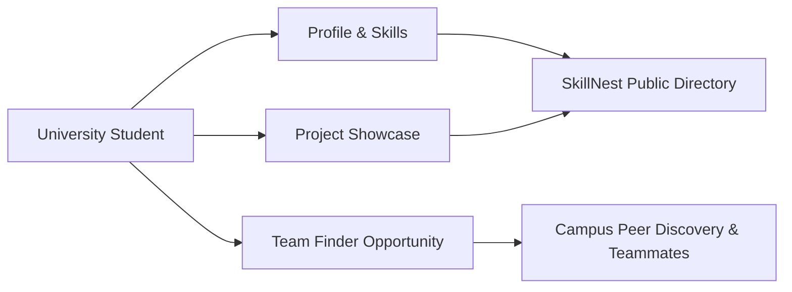
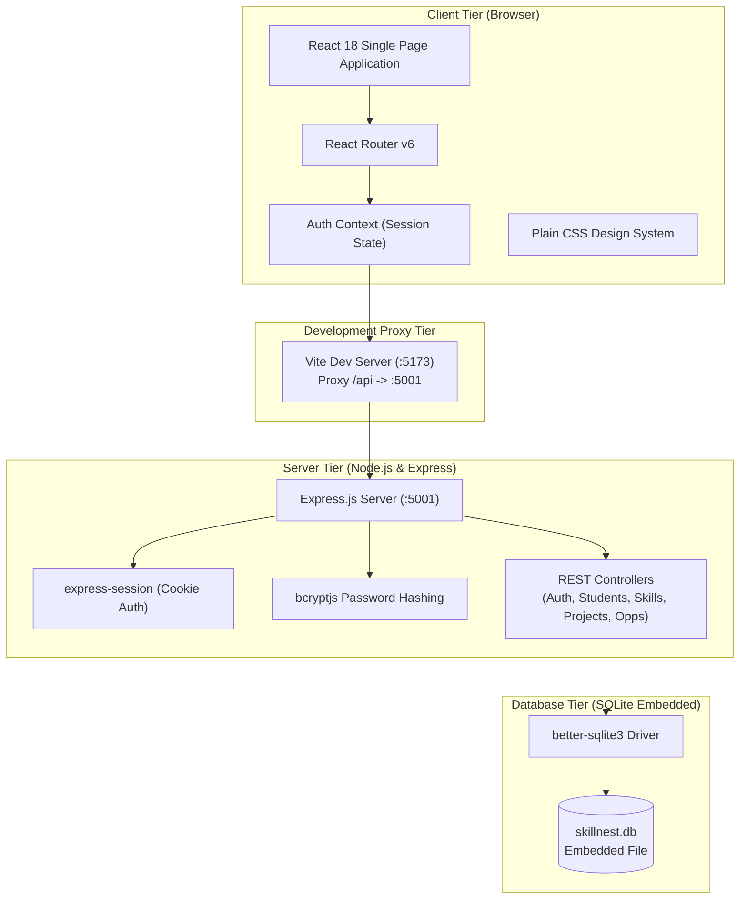
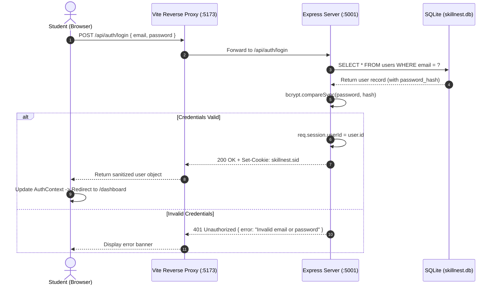
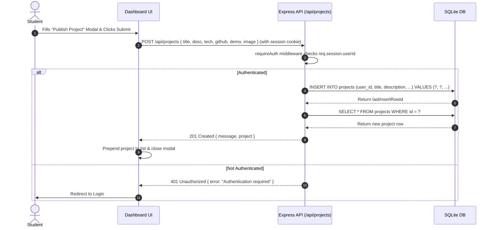
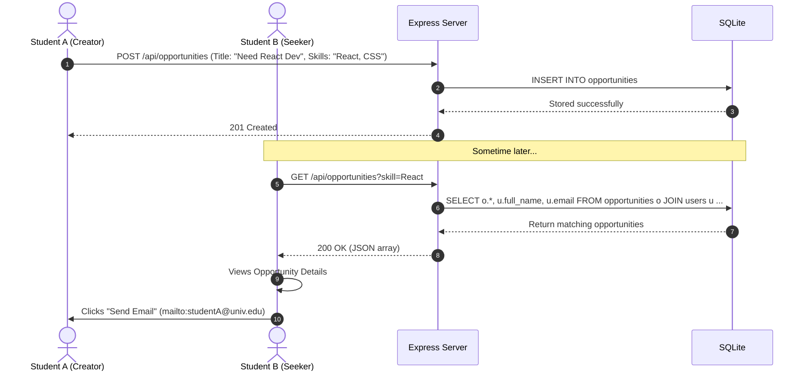
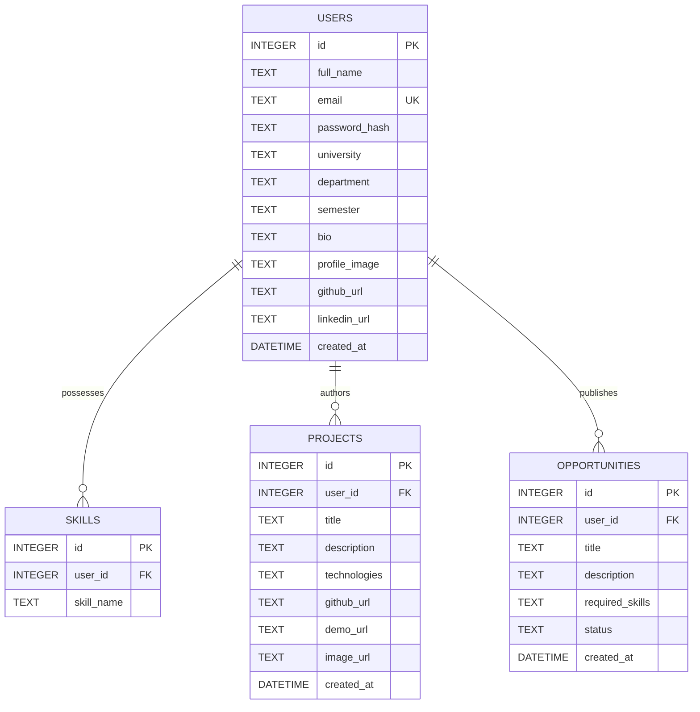

# SkillNest — Comprehensive Project Documentation & Architecture Guide

> **Academic Degree Context:** 7th-Semester Computer Science & Engineering Capstone Project  
> **Project Title:** SkillNest (Student Portfolio & Teammate Discovery Network)  
> **Repository:** `skillnest-student-portfolio`  
> **Author / Maintainer:** SkillNest Academic Project Team  
> **Target Audience:** Evaluators, Viva Examiners, Project Supervisors, and Contributing Developers

---

## Table of Contents
1. [Executive Summary & Motivation](#1-executive-summary--motivation)
2. [High-Level System Architecture](#2-high-level-system-architecture)
3. [Deep-Dive Feature Explanation](#3-deep-dive-feature-explanation)
4. [System Workflows & Sequence Diagrams](#4-system-workflows--sequence-diagrams)
5. [Database Design & Data Dictionary](#5-database-design--data-dictionary)
6. [Complete REST API Specification](#6-complete-rest-api-specification)
7. [Installation, Environment & Execution Guide](#7-installation-environment--execution-guide)
8. [University Viva & Presentation Defense Guide](#8-university-viva--presentation-defense-guide)

---

## 1. Executive Summary & Motivation

### 1.1 The Academic Problem
During undergraduate studies in Computer Science and Engineering, students routinely develop laboratory assignments, term projects, and competitive hackathon prototypes. Despite writing non-trivial software:
- **Dispersed Portfolios:** Their code and demos remain fragmented across personal laptops, Google Drives, or untagged GitHub repositories.
- **Generic Professional Networks:** Platforms like LinkedIn or traditional resumes focus on corporate work history and omit academic-specific attributes (e.g., current semester, university major, or specific coursework).
- **Capstone Team Asymmetry:** Forming multidisciplinary or complementary teams for final-year projects often relies on proximity or social cliques, causing skill imbalances (e.g., a team with four backend developers and no frontend designer).

### 1.2 The SkillNest Solution
**SkillNest** is an open-source, lightweight web application engineered to bridge the gap between student portfolios and peer collaboration:
- Centralizes academic credentials, social profiles (GitHub, LinkedIn), and verified skill sets.
- Provides a public, printable portfolio link (`/students/:id`) that doubles as an academic CV.
- Hosts a dedicated **Team Finder Board** where students can post collaboration requests specifying desired skill tags (e.g., React, PyTorch, C++).



---

## 2. High-Level System Architecture

SkillNest follows a **Three-Tier Client-Server Architecture** adhering to clean separation of concerns:



### 2.1 Architectural Highlights
1. **Zero-Configuration Embedded Storage:** SQLite (`better-sqlite3`) eliminates the need for external database servers (like MySQL, Postgres, or MongoDB). The database file lives directly on disk at `server/database/skillnest.db`.
2. **Reverse Proxying without Cross-Origin Issues:** Vite proxies `/api` calls directly to the Express server. The browser communicates with a single origin (`localhost:5173`), preventing cross-origin cookie drop issues.
3. **Session-Based Authentication:** Standard HTTP-only cookies (`skillnest.sid`) store cryptographic session IDs. Passwords are never sent back through the API.
4. **Pure CSS without Heavy Utility Frameworks:** Built with native CSS Custom Properties, flexbox, and CSS grid, minimizing bundle size and external dependencies.

---

## 3. Deep-Dive Feature Explanation

### 3.1 Public Landing Page (`/`)
- **Hero Section:** High-contrast header with headline *"Your Skills. Your Projects. Your Future."*, dynamic statistics, and primary call-to-action buttons.
- **How It Works:** Three-step visual breakdown (Create Profile $\rightarrow$ Showcase Projects $\rightarrow$ Find Teammates).
- **Featured Projects Carousel/Grid:** Pulls the latest three verified student projects directly from the SQLite database.
- **Student Community Preview:** Highlights registered students across different universities.

### 3.2 Authentication & Route Guards (`/login`, `/register`)
- **Registration Fields:** Full Name, University Email, University Name, Department, Current Semester (dropdown), Password, Confirm Password.
- **Input Validation:** Email format validation, duplicate email collision checks, and 6-character minimum password enforcement.
- **Password Protection:** Uses `bcryptjs` with 10 salt rounds. Plaintext passwords never touch the database.
- **Quick Demo Fill:** A one-click button on the Login page instantly populates `demo@skillnest.local` and `Demo123!` for smooth live demonstrations.
- **ProtectedRoute Component:** Wraps private routes (like `/dashboard`). Unauthenticated requests are redirected to `/login` with an intuitive post-login return redirect.

### 3.3 Student Dashboard (`/dashboard`)
The command center for authenticated students, organized into intuitive tabs:
1. **Overview Tab:**
   - **Profile Strength Meter (%):** Calculates profile completeness based on filled attributes (Base fields: 50%, Bio: +10%, Avatar: +10%, GitHub URL: +10%, LinkedIn URL: +10%, Skills: +10%). Displays contextual tips to reach 100%.
   - **Quick Stat Counters:** Total Technical Skills, Published Projects, and Active Collaboration Posts.
   - **Recent Activity Previews:** Summary cards of the student's projects and opportunities.
2. **My Skills Tab:**
   - Input field to add skills as interactive chips.
   - Case-insensitive duplicate prevention.
   - One-click removal button (`x`) for each skill.
3. **My Projects Tab:**
   - Visual grid of projects owned by the student.
   - Modal form to publish new projects or edit existing ones.
   - Secure deletion with confirmation dialog.
4. **My Opportunities Tab:**
   - Management table/cards for posted collaboration requests.
   - Status toggle between **Open** (actively looking) and **Closed** (teammate found).
5. **Edit Profile Tab:**
   - Updates personal info, university, department, semester, bio, and social links.

### 3.4 Student Directory & Multi-Criteria Filtering (`/students`)
- **Comprehensive Search:** Substring search across student names and biographies.
- **Multi-Filter Support:** Independent or combined filtering by:
  - University name (e.g., "State University")
  - Department (e.g., "Computer Science")
  - Technical Skill (e.g., "React", "Python", "Machine Learning")
- **Clickable Tag Filtering:** Clicking any skill tag anywhere in the directory immediately triggers a filtered query for that skill.
- **Reset Filters:** Instant return to full directory view.

### 3.5 Public Student Profile & Academic CV Mode (`/students/:id`)
- Displays the student's verified credentials, semester status, bio, and avatar.
- Lists all active technical skills and project cards.
- **Share Portfolio Link:** Copies the canonical public URL directly to the user's clipboard.
- **Print CV Mode:** Features specialized `@media print` CSS rules that hide navigation bars, buttons, and footers, transforming the web page into an academic CV ready for PDF export or paper printing.
- **Contact Student:** Provides a `mailto:` link pre-filled with the inquiry subject.

### 3.6 Project Showcase (`/projects` & `/projects/:id`)
- Public catalog of all student creations across engineering disciplines.
- Each project card displays cover imagery (or fallback gradient banner), technologies used, GitHub repository button, and live demo link.
- Detail page provides project overview, author affiliation card, and direct links to the author's full portfolio.

### 3.7 Team Finder Board (`/team-finder` & `/team-finder/:id`)
- Open marketplace for campus collaboration.
- Students can browse open teammate requests and filter by required technical skills or status.
- Direct posting: Published opportunities appear immediately on the board without administrative friction.

---

## 4. System Workflows & Sequence Diagrams

### 4.1 Authentication & Session Verification Flow



---

### 4.2 Project Creation Flow



---

### 4.3 Team Opportunity Discovery Flow



---

## 5. Database Design & Data Dictionary

SkillNest uses an embedded SQLite relational database with strict foreign keys enabled (`PRAGMA foreign_keys = ON;`).



### 5.1 Tables & Columns Description

#### 1. `users` Table
Stores student academic profiles and credentials.
| Column | Type | Constraints | Description |
| :--- | :--- | :--- | :--- |
| `id` | INTEGER | PRIMARY KEY, AUTOINCREMENT | Unique student identifier. |
| `full_name` | TEXT | NOT NULL | Student's full legal/academic name. |
| `email` | TEXT | UNIQUE, NOT NULL | University or personal email used for login. |
| `password_hash` | TEXT | NOT NULL | Salted bcrypt hash of the password. |
| `university` | TEXT | NOT NULL | University or college name. |
| `department` | TEXT | NOT NULL | Department/program (e.g., Computer Science). |
| `semester` | TEXT | NOT NULL | Current academic semester (e.g., "7th Semester"). |
| `bio` | TEXT | DEFAULT '' | Brief personal summary. |
| `profile_image` | TEXT | DEFAULT '' | URL to avatar picture. |
| `github_url` | TEXT | DEFAULT '' | Full URL to student's GitHub profile. |
| `linkedin_url` | TEXT | DEFAULT '' | Full URL to student's LinkedIn profile. |
| `created_at` | DATETIME | DEFAULT CURRENT_TIMESTAMP | Registration timestamp. |

#### 2. `skills` Table
Stores individual technical skills linked to students.
| Column | Type | Constraints | Description |
| :--- | :--- | :--- | :--- |
| `id` | INTEGER | PRIMARY KEY, AUTOINCREMENT | Unique skill record ID. |
| `user_id` | INTEGER | NOT NULL, FK $\rightarrow$ `users(id)` ON DELETE CASCADE | Associated student ID. |
| `skill_name` | TEXT | NOT NULL | Name of skill (e.g., "React", "Python"). |

#### 3. `projects` Table
Stores student projects and portfolio artifacts.
| Column | Type | Constraints | Description |
| :--- | :--- | :--- | :--- |
| `id` | INTEGER | PRIMARY KEY, AUTOINCREMENT | Unique project ID. |
| `user_id` | INTEGER | NOT NULL, FK $\rightarrow$ `users(id)` ON DELETE CASCADE | Author student ID. |
| `title` | TEXT | NOT NULL | Title of the project. |
| `description` | TEXT | NOT NULL | Full overview of the project. |
| `technologies` | TEXT | NOT NULL | Comma-separated tech stack list. |
| `github_url` | TEXT | NOT NULL | Repository link. |
| `demo_url` | TEXT | DEFAULT '' | Optional live preview link. |
| `image_url` | TEXT | DEFAULT '' | Optional screenshot/cover image URL. |
| `created_at` | DATETIME | DEFAULT CURRENT_TIMESTAMP | Publication timestamp. |

#### 4. `opportunities` Table
Stores collaboration and teammate requests for the Team Finder board.
| Column | Type | Constraints | Description |
| :--- | :--- | :--- | :--- |
| `id` | INTEGER | PRIMARY KEY, AUTOINCREMENT | Unique opportunity ID. |
| `user_id` | INTEGER | NOT NULL, FK $\rightarrow$ `users(id)` ON DELETE CASCADE | Creator student ID. |
| `title` | TEXT | NOT NULL | Opportunity title (e.g., "Looking for React Dev"). |
| `description` | TEXT | NOT NULL | Details on the project and required assistance. |
| `required_skills`| TEXT | NOT NULL | Comma-separated skills needed. |
| `status` | TEXT | DEFAULT 'Open' | Status: either `'Open'` or `'Closed'`. |
| `created_at` | DATETIME | DEFAULT CURRENT_TIMESTAMP | Creation timestamp. |

---

## 6. Complete REST API Specification

All API endpoints return JSON responses. Protected endpoints require an active session cookie (`skillnest.sid`).

### 6.1 Authentication (`/api/auth`)
| Method | Endpoint | Auth | Description |
| :--- | :--- | :--- | :--- |
| `POST` | `/api/auth/register` | No | Registers a new student and sets session. |
| `POST` | `/api/auth/login` | No | Validates credentials and sets session cookie. |
| `POST` | `/api/auth/logout` | Yes | Destroys current session and clears cookie. |
| `GET` | `/api/auth/me` | No | Returns current user object or `{ user: null }`. |

### 6.2 Students & Profiles (`/api/students`, `/api/profile`)
| Method | Endpoint | Auth | Query Parameters / Body | Description |
| :--- | :--- | :--- | :--- | :--- |
| `GET` | `/api/students` | No | `search`, `university`, `department`, `skill` | Directory list with attached skills and project counts. |
| `GET` | `/api/students/:id` | No | None | Full profile with skills, projects, and open opportunities. |
| `PUT` | `/api/profile` | Yes | `{ full_name, university, department, semester, bio, ... }` | Updates authenticated student's profile. |

### 6.3 Skills (`/api/skills`)
| Method | Endpoint | Auth | Body | Description |
| :--- | :--- | :--- | :--- | :--- |
| `POST` | `/api/skills` | Yes | `{ skill_name }` | Adds a new skill tag (prevents duplicates). |
| `DELETE`| `/api/skills/:id` | Yes | None | Deletes skill belonging to the authenticated student. |

### 6.4 Projects (`/api/projects`)
| Method | Endpoint | Auth | Description |
| :--- | :--- | :--- | :--- |
| `GET` | `/api/projects` | No | Returns all projects (supports `limit`, `search`, `technology`). |
| `GET` | `/api/projects/:id` | No | Returns single project details with creator info. |
| `POST` | `/api/projects` | Yes | Publishes a new project for the authenticated user. |
| `PUT` | `/api/projects/:id` | Yes | Updates a project (author ownership verified). |
| `DELETE`| `/api/projects/:id` | Yes | Deletes a project (author ownership verified). |

### 6.5 Collaboration Opportunities (`/api/opportunities`)
| Method | Endpoint | Auth | Description |
| :--- | :--- | :--- | :--- |
| `GET` | `/api/opportunities` | No | Returns all team opportunities (filters by `status`, `skill`, `search`). |
| `GET` | `/api/opportunities/:id`| No | Returns single opportunity details with owner information. |
| `POST` | `/api/opportunities` | Yes | Posts a new collaboration opportunity. |
| `PUT` | `/api/opportunities/:id` | Yes | Updates an existing opportunity (owner verified). |
| `DELETE`| `/api/opportunities/:id` | Yes | Deletes an opportunity (owner verified). |

---

## 7. Installation, Environment & Execution Guide

### 7.1 System Requirements
- **Operating System:** macOS, Windows 10/11, or Linux (Ubuntu, Debian, Fedora, Arch).
- **Node.js:** v20.x, v22.x LTS (Recommended).
- **NPM:** v10.x or newer.

### 7.2 Zero-Config Startup Process

```bash
# 1. Clone repository
git clone https://github.com/USERNAME/skillnest-student-portfolio.git
cd skillnest-student-portfolio

# 2. Install all root dependencies
npm install

# 3. Start development environment
npm run dev
```

The terminal will launch both services in parallel using `concurrently`:
```
[SERVER] SkillNest Backend API is running! http://localhost:5001
[CLIENT] VITE ready in 150 ms http://localhost:5173/
```

### 7.3 Resetting the Database
If you modify sample students or add experimental projects and wish to restore a pristine environment:
```bash
npm run db:reset
```
This utility script deletes `server/database/skillnest.db` and immediately recreates all tables with the 5 default students, 30 skills, 6 projects, and 3 opportunities.

---

## 8. University Viva & Presentation Defense Guide

This section is prepared specifically to help students answer theoretical, architectural, and design questions during an academic project evaluation.

### Q1: Why did you choose SQLite over MongoDB or PostgreSQL?
> **Answer:** "For a university capstone project, ease of deployment and portability are critical. PostgreSQL or MongoDB require running a separate background database server, configuring connection strings, handling network latency, and installing external database management tools. SQLite is a serverless, zero-configuration embedded database. It stores everything in a single, high-performance local file (`skillnest.db`). Using `better-sqlite3`, it delivers synchronous, low-latency execution with full ACID compliance and relational foreign key constraints without requiring any setup from the evaluator."

### Q2: How do you handle password security in SkillNest?
> **Answer:** "Passwords are never stored or transmitted in plain text. When a student registers, we use `bcryptjs` with an adaptive work factor of 10 salt rounds to generate a cryptographically strong one-way hash. During authentication, `bcrypt.compareSync` compares the provided plaintext password against the stored hash. In addition, our `sanitizeUser` utility guarantees that `password_hash` is stripped from all API responses, preventing credential leakage."

### Q3: Why use session cookies instead of JWT (JSON Web Tokens)?
> **Answer:** "While JWTs are popular for distributed microservices, they carry known security tradeoffs for standard web applications: they cannot be easily revoked before expiration, and storing them in browser `localStorage` exposes them to Cross-Site Scripting (XSS) attacks. We chose `express-session` with `httpOnly: true` cookies. This ensures JavaScript cannot read the session cookie directly, mitigating XSS risks. Furthermore, when a student logs out, the session is instantly destroyed on the server."

### Q4: How does Vite proxy API requests to Express without CORS issues?
> **Answer:** "During development, the frontend runs on port `5173` and the backend runs on port `5001`. If the browser made cross-origin requests directly from 5173 to 5001, browser security would enforce CORS preflight requests and restrict cookies under certain domain policies. To solve this, Vite is configured with a reverse proxy in `vite.config.js`: any request starting with `/api` is transparently forwarded to `http://localhost:5001`. From the browser's viewpoint, all traffic is same-origin."

### Q5: Why plain CSS instead of Tailwind CSS or Bootstrap?
> **Answer:** "Avoiding large utility frameworks ensures that the code remains beginner-friendly, readable, and free of complex build-time dependencies. We created a modular CSS architecture using native CSS variables (`--primary`, `--navy-dark`, `--shadow-md`), flexbox, and grid. This results in an ultra-fast build (under 1 second), lightweight bundle size (~15KB CSS), and custom styles tailored specifically for academic portfolios, including dedicated `@media print` rules for resume generation."

### Q6: How does the Profile Completion Percentage formula work?
> **Answer:** "Profile completion is computed dynamically using a deterministic scoring function in `server/routes/auth.js`:
> - Required base fields (Name, Email, University, Department, Semester): **50%**
> - Short biography: **+10%**
> - Profile picture URL: **+10%**
> - GitHub profile URL: **+10%**
> - LinkedIn profile URL: **+10%**
> - At least one technical skill tag: **+10%**
> 
> Total = **100%**. This provides immediate gamified feedback for students to fill out their profiles."

---

## 9. Conclusion
SkillNest demonstrates a complete, production-grade full-stack architecture that remains simple to run and defend. With modern frontend practices, robust session security, parameterized SQL queries, and zero-setup deployment, it fulfills all requirements for a distinguished 7th-Semester Computer Science university project.

